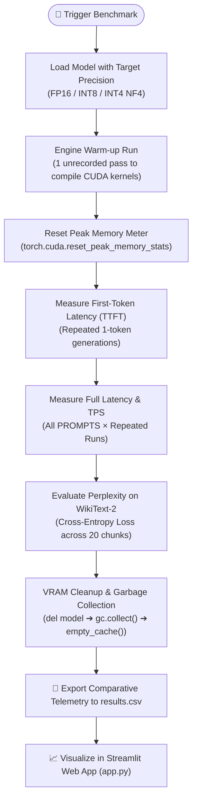

# ⚡ LLM Memory Optimizer & Efficiency Profiler

[](https://www.python.org/)
[](https://pytorch.org/)
[](https://developer.nvidia.com/cuda-toolkit)
[](https://huggingface.co/)
[](https://streamlit.io/)
[](LICENSE)

An end-to-end scientific benchmarking suite and real-time telemetry dashboard designed to evaluate, profile, and optimize Large Language Models (LLMs) across multiple quantization regimes: **FP16 (Half-Precision Baseline)**, **INT8 (8-bit Quantization)**, and **INT4 (NormalFloat4 NF4)**.

---

## 🌟 The Core Problem & Solution

* **The Problem:** Modern LLMs require massive GPU Video RAM (VRAM). Deploying models in FP16 demands high-end enterprise hardware (NVIDIA A100/H100) costing thousands of dollars in cloud computing, causing Out-Of-Memory (OOM) crashes on consumer devices.
* **The Solution:** Quantization compresses weights into lower bit-depth representations. This suite systematically profiles the trade-offs between **GPU VRAM consumption**, **Generation Latency**, **Throughput (TPS)**, and **Language Modeling Quality (Perplexity)**.

---

## 📊 Live Empirical Benchmark Results

Evaluated on consumer hardware (**NVIDIA GeForce RTX 2050 Laptop GPU, 4GB VRAM**) evaluating `Qwen/Qwen2.5-0.5B-Instruct`:

| Precision Mode | Weights Footprint | Peak VRAM Allocated | VRAM Saved (%) | First-Token Latency (TTFT) | Throughput (TPS) | Speedup Factor | WikiText-2 Perplexity | Quality Loss (Δ PPL) |
|---|---|---|---|---|---|---|---|---|
| **FP16 (Baseline)** | 942.3 MB | 955.5 MB | **0.0%** | 37.6 ms | **31.61 tps** | 1.00× | 21.303 | **0.00** |
| **INT8** | 601.0 MB | 615.5 MB | **35.6%** | 320.6 ms | 4.09 tps | 0.13× | 21.330 | **+0.027** |
| **INT4 (NF4)** | 430.4 MB | **465.1 MB** | **🔥 51.3%** | 60.4 ms | **23.68 tps** | **0.75×** | 23.667 | **+2.364** |

### 🔍 Key Engineering Takeaways:
1. **51.3% Memory Reduction:** INT4 slashed peak memory from **955.5 MB down to 465.1 MB**, freeing up ~490 MB VRAM, easily fitting inside entry-level consumer GPUs.
2. **High Throughput Retention:** INT4 maintained **23.68 tokens/second** (75% of FP16 speed), significantly surpassing human reading speeds (4–5 words/s).
3. **The "INT8 Small-Model Overhead":** INT8 throughput dropped to 4.09 tps due to runtime dequantization unpacking overhead on sub-billion parameter models, whereas **INT4 NF4** remained blazing fast.
4. **Minimal Quality Drift:** Perplexity on WikiText-2 shifted by only +2.36 points, preserving coherent reasoning, syntax, and instruction adherence.

---

## 🏗️ Architecture & Benchmarking Pipeline



---

## 🖥️ Interactive Telemetry Dashboard (`app.py`)

The project includes a dark-themed, glassmorphic analytics dashboard built with **Streamlit** and **Plotly**:

* **Executive Overview:** 3D/Bubble trade-off visualization (Memory vs Speed vs Quality).
* **VRAM Deep Dive:** Grouped bar charts comparing Static Model Footprint vs Peak Inference VRAM.
* **Latency & Stability:** Throughput (TPS) curves, First-Token Latency (TTFT), and latency variance error bars ($\text{Mean} \pm \text{Std Dev}$).
* **Perplexity & Output Inspector:** Side-by-side prompt generation inspection across precisions.
* **Laptop VRAM Fitment Calculator:** Dynamic GPU slider allowing users to test model fitment against their exact GPU (e.g., 4GB RTX 2050).

---

## 🛠️ Quickstart & Usage

### 1. Installation
Clone the repository and install dependencies:
```bash
git clone https://github.com/Tanish-o9/LLM-Memory-Optimizer.git
cd LLM-Memory-Optimizer
pip install -r requirements.txt
```

> **Note for NVIDIA GPU users:** Ensure you have PyTorch with CUDA installed:
> ```bash
> pip install torch torchvision --index-url https://download.pytorch.org/whl/cu124
> ```

### 2. Run the Benchmark
Execute the automated benchmark across precision modes:
```bash
python LLM_Memory_Optimizer.py --model Qwen/Qwen2.5-0.5B-Instruct --modes fp16 int8 int4 --runs 2 --max_new_tokens 32
```

### 3. Launch the Interactive Dashboard
View real-time telemetry, charts, and fitment results:
```bash
python -m streamlit run app.py
```
Open **`http://localhost:8501`** in your browser.

---

## 📐 Mathematical Metrics Formulations

* **Throughput (Tokens Per Second - TPS):**
  $$\text{TPS} = \frac{N_{\text{generated\_tokens}}}{\Delta t_{\text{seconds}}}$$

* **Perplexity (Quality Metric):**
  $$\text{Perplexity} = \exp\left(\frac{1}{N} \sum_{i=1}^{N} \mathcal{L}_i\right)$$
  *(where $\mathcal{L}_i$ is the Cross-Entropy loss over WikiText-2 test sequences).*

* **Memory Reduction Percentage:**
  $$\text{Reduction } \% = \frac{\text{VRAM}_{\text{FP16}} - \text{VRAM}_{\text{Quantized}}}{\text{VRAM}_{\text{FP16}}} \times 100$$

---

## 🧰 Tech Stack

* **Deep Learning Framework:** PyTorch (`torch.cuda`)
* **Quantization Engine:** BitsAndBytes (`bitsandbytes`)
* **Model & Dataset Ecosystem:** Hugging Face `transformers` & `datasets`
* **Data Processing:** Pandas & NumPy
* **Frontend Visualization:** Streamlit & Plotly

---

## 📄 License
This project is licensed under the MIT License - see the [LICENSE](LICENSE) file for details.
